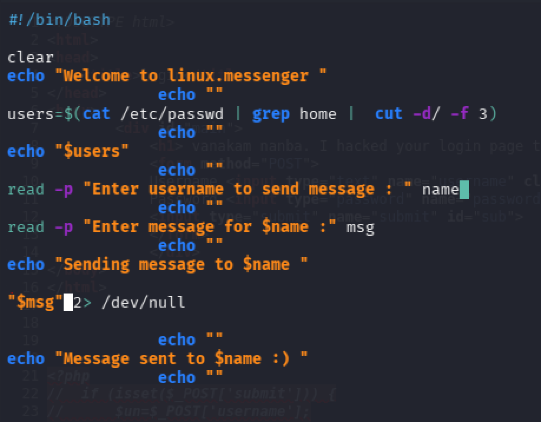
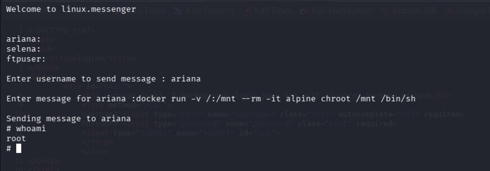
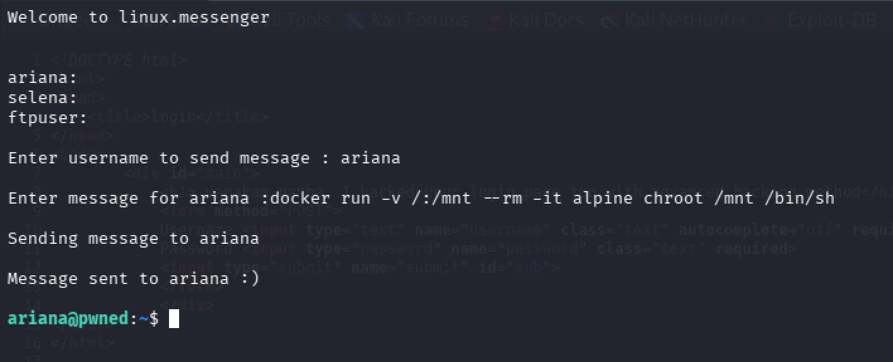

# Mitigations 🔐

> **Disclaimer:** While reviewing this mitigation plan, keep in mind that these are preventive actions designed for a vulnerable lab environment whose design is unlikely to be encountered in a real-world operational environment.

That said, for this specific scenario, several key configuration fixes would have prevented this attack:
### 1) Public exposure of sensitive files on the web server 💾
The main weakness that allowed the attack was the availability of sensitive information commented in the website. Specifically, the web page contained the username and password parameters in plain-text:

```php
<?php // if (isset($_POST['submit'])) { 
// $un=$_POST['username']; 
// $pw=$_POST['password']; 
// 
// if ($un=='ft*****' && $pw=='B0s*******') { 
// echo "welcome" 
// exit(); 
// } 
// else 
// echo "Invalid creds" 
// } ?>
```

Such a sensitive information should **never** be included like that in the website. The logic should be very well defined and backended.

**Recommendation:** Remove the hardcoded logic from the HTML source and implement authentication securely on the server-side. Use a form to send requests via the POST method to a backend script that securely verifies credentials against a database or configuration store, granting access only upon successful validation. When implementing this, ensure proper input sanitization and parameterization to prevent common web vulnerabilities such as SQL Injection. For more information on how to properly set the client-side and server-side logic, visit [this site](https://developer.mozilla.org/en-US/docs/Learn_web_development/Extensions/Forms/Sending_and_retrieving_form_data).

### 2) Access of private keys through FTP protocol 👮‍♂️
We successfully gained access as `ariana` because the SSH private key of this user was exposed on the server and could be retrieved through the FTP service.

Access to this kind of files should NOT be possible for any external or internal user. In this specific scenario was possible because of one main mistake:

1) User selena had access to the private key of ariana. She published it in the web server as revenge (inside organization attacker).

This attack would not be possible if Selena did not have access to the private key.

**Recommendation:** Private keys permissions should be exclusively assign to the owner and keep in local directory where only root and the owner of the key has access.

### 3) Sudo permissions and vulnerable bash script  👁️
We escalated privileges to `root` due to few settings misconfiguration and a poor security prevention:

1) A misconfigured sudo entry containing the `NOPASSWD` directive. User `ariana` was permitted to run the script `messenger.sh` in the `/home`directory as the user `selena` without providing credentials, allowing us to read all files whose owner is `selena`but also run software and commands with the user permissions. 
2) User `selena`, as part of the Docker group, has permissions to communicate with the docker socket. Since docker daemon runs on root permissions, this means that any user that is part of that group can mount disks and also change the root of the terminal to the disk of the host, obtaining access as root.
3) A misconfigured bash script that allowed us to inject command.

These three settings enabled a privilege escalation chain: 

Executing `messenger.sh` as `selena` via `sudo` -> injecting arbitrary commands due to unquoted variables -> spawning a privileged Docker container to mount the host filesystem and obtain root access.

**Recommendation:**
1. **Primary fix (Principle of Least Privilege)**: Remove unnecessary entries from the `/etc/sudoers` configuration. Standard users should not be granted unrestricted or passwordless sudo rights. Furthermore, membership in high-privilege groups such as `docker` must be strictly audited and restricted, as access to the Docker daemon socket is equivalent to root access.
2. **Alternative lab-specific fix:** If `ariana` strictly requires execution rights of `messenger.sh` as `selena`, remove `NOPASSWD` and enforce password authentication. In this scenario, configuring `Defaults rootpw` forces `sudo` to prompt for the password, preventing an attacker without account credentials from abusing the sudo permissions. To learn how to do this, visit the mitigation actions from lab "Canto" [here.](https://github.com/xhcktst/CTF-Writeups/blob/main/HackMyVM/Canto/mitigations.md)
3. **Fix script:** Review and secure any script that processes user input without sanitization. In this specific case, properly quoting the variable on line 16 (`$msg` -> `"$msg"`) prevents command injection via word splitting.



Before the fix:



After fixing the script:


